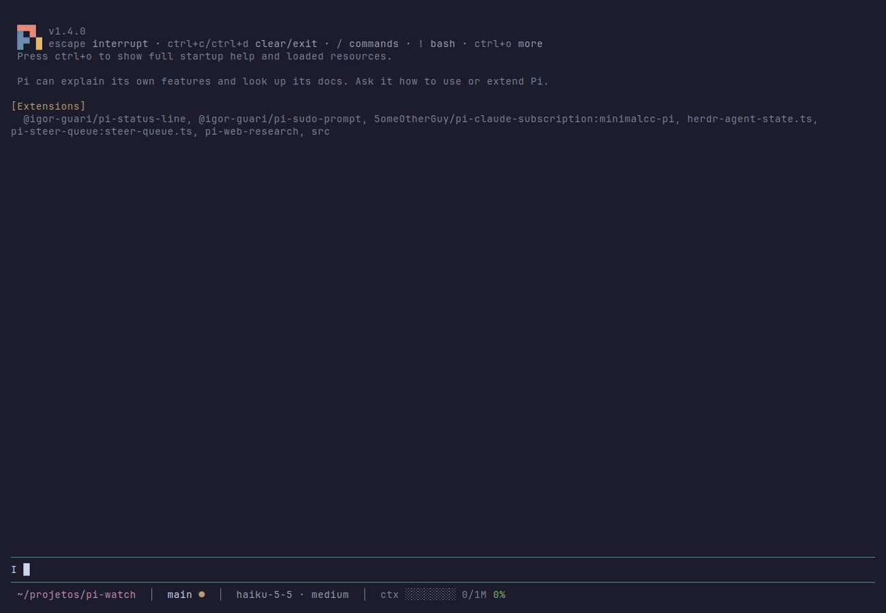
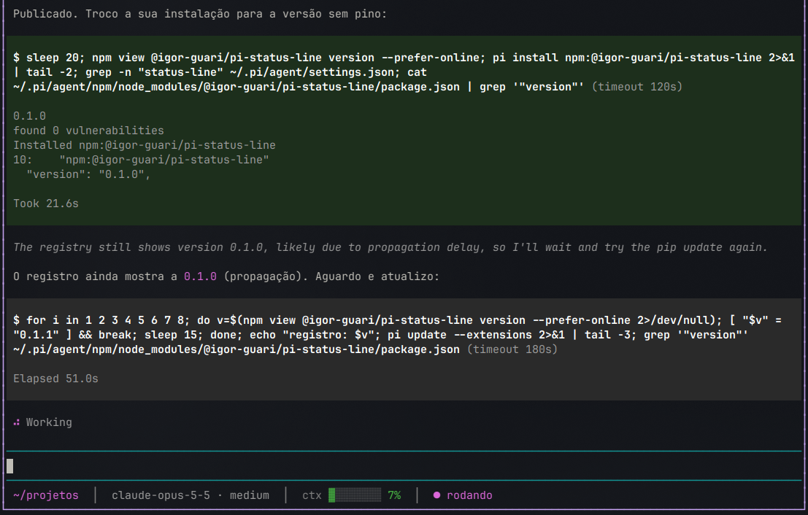

# pi-watch

Wait for anything **without blocking the turn** in the [Pi coding agent](https://pi.dev).

The agent registers a **goal**, a **success** condition, an optional **failure** condition and a **deadline**. It ends its turn right away — you get Pi back — and when the condition is met (or the deadline expires) the extension **wakes Pi up** with the goal and the observed data so it can continue.

No `sleep`. No `for … sleep 15; done` loops. No bash timeouts.



## Why

Without it, waiting looks like this — the turn is stuck on *Working* for minutes, the loop races the bash timeout, and you can't use Pi meanwhile:



With pi-watch the same wait is one tool call; the turn ends in seconds and Pi resumes on its own when the registry shows the new version.

## Install

```bash
pi install npm:@igor-guari/pi-watch
# or
pi install git:github.com/IgorGuariroba/pi-watch
```

Try without installing: `pi -e npm:@igor-guari/pi-watch`.

## How it works

Every watch always ends in exactly one outcome — it can never wait forever:

| Outcome | When |
|---|---|
| ✅ `success` | the `success` condition matched |
| ❌ `failure` | the `failure` condition matched, or the watched process exited without matching `success` |
| ⌛ `timeout` | `timeoutMs` (required, estimated by the agent) expired — the last observation is included |
| ❗ `error` | the poll command cannot run (exit 126/127) |

Watches settling within ~2s of each other are delivered in a single message. If the agent is idle it is woken up; if it is busy the result is queued as a follow-up.

### Sources

- **process** — a command started in the background with `process_start`. Conditions are checked on every output line (`line`, `stream`) and on exit (`exitCode`, `signal`).
- **poll** — a cheap status command re-run every `intervalMs` (default 15s, min 2s, optional backoff) *outside* the turn. Conditions see `exitCode`, `stdout`, `stderr`, `json` (stdout parsed as JSON), `attempt`.

### Conditions

Declarative, no `eval`:

```jsonc
{ "exitCode": { "eq": 0 } }
{ "line": { "regex": "Listening on :\\d+" } }
{ "stdout": { "eq": "0.2.0" } }
{ "all": [ { "json.status": { "eq": "completed" } }, { "json.conclusion": { "ne": "success" } } ] }
```

Operators: `eq`, `ne`, `gt`, `lt`, `in`, `regex`, `contains`, combined with `all` / `any`. A field absent from the observation never matches (an output line has no `exitCode`).

## Examples

**Tests in the background**

```jsonc
// process_start
{ "cmd": "npm test", "watch": { "goal": "test suite passes", "success": { "exitCode": { "eq": 0 } }, "timeoutMs": 600000 } }
```

**npm publish propagation**

```jsonc
// watch_create
{
  "goal": "registry shows @me/pkg@0.2.0",
  "poll": { "cmd": "npm view @me/pkg version --prefer-online", "intervalMs": 15000 },
  "success": { "stdout": { "eq": "0.2.0" } },
  "timeoutMs": 600000
}
```

**GitHub Actions run**

```jsonc
{
  "goal": "CI run 123 finishes green",
  "poll": { "cmd": "gh run view 123 --json status,conclusion" },
  "success": { "all": [{ "json.status": { "eq": "completed" } }, { "json.conclusion": { "eq": "success" } }] },
  "failure": { "all": [{ "json.status": { "eq": "completed" } }, { "json.conclusion": { "ne": "success" } }] },
  "timeoutMs": 1800000
}
```

(Or `process_start` with `gh run watch 123 --exit-status` / `glab ci status --live` and `success: { exitCode: { eq: 0 } }`.)

**Deploy health check**

```jsonc
{
  "goal": "staging answers 200",
  "poll": { "cmd": "curl -s -o /dev/null -w '%{http_code}' https://staging.example.com/health" },
  "success": { "stdout": { "eq": "200" } },
  "timeoutMs": 300000
}
```

## Tools

| Tool | What it does |
|---|---|
| `process_start` | Start a command in the background (log to file); optional inline `watch` |
| `process_list` / `process_logs` / `process_kill` | Inspect, read (`tail`, `grep`) and stop background processes |
| `watch_create` | Register a watch on a process (`processId`) or a `poll` |
| `watch_list` / `watch_cancel` | List or cancel active watches |

## Sleep guard

`bash` calls with `sleep N` (N ≥ 10s) or any `for/while/until … sleep … done` loop are **blocked** with a hint to use a watch instead. Short sleeps and `sleep` inside quotes/comments pass.

## UI

- Status: `⏳ 2 watches · 1m12s · 1 proc`
- `/watches` — list active watches and processes, pick one to cancel/kill
- Wake-up messages are rendered compactly (expand to see the output tail)

## Configuration

| Env var | Default | |
|---|---|---|
| `PI_WATCH_MAX_TIMEOUT_MS` | `7200000` (2h) | upper bound for `timeoutMs` |
| `PI_WATCH_SLEEP_THRESHOLD_S` | `10` | sleeps at/above this are blocked |
| `PI_WATCH_BLOCK_SLEEP` | `1` | `0` disables the sleep guard |

## Lifecycle

Everything lives as long as the Pi session: on quit, `/new`, `/resume`, fork or reload, active watches are cancelled and background processes are stopped (SIGTERM, then SIGKILL). Logs stay in `$TMPDIR/pi-watch/<pid>/`.

Limits: 10 active watches, one-shot (a watch settles once).

## Development

```bash
npm test                                  # node --test (Node 22.6+), no dependencies
pi -e ./src/index.ts                      # load the local extension
node scripts/rpc-smoke.mjs "<prompt>" 2   # drive a real Pi over RPC and watch it wake up
```

`src/condition.ts`, `src/sleep-guard.ts` and `src/watch-manager.ts` have no Pi imports and carry the tests; `src/index.ts` wires them to Pi.

## License

MIT
